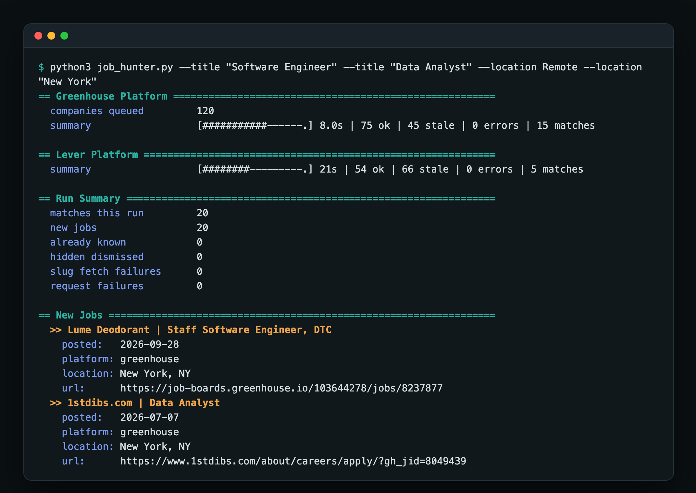
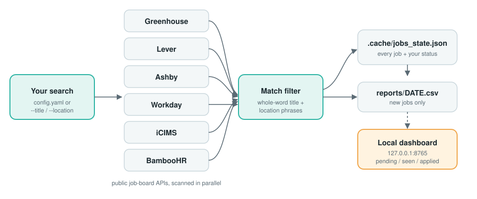

# Job Hunter

[](https://github.com/okarois/job-hunter/actions/workflows/ci.yml)


**Tell it the jobs and places you want. It scans thousands of company career pages and keeps a private, local list of matches.**

Job Hunter reads the public job boards that most companies use (Greenhouse, Lever, Ashby, Workday, iCIMS and BambooHR), keeps only the roles that match **your** job titles and locations, remembers everything it has found, and gives you a small dashboard to work through the list. There is no account, no hosted service and no database. Everything stays on your computer.


## Features

- **Your own search.** Set any job titles and locations in a simple file, or pass them on the command line.
- **Six job-board platforms** and tens of thousands of companies, found automatically.
- **Smart matching.** Whole-word matching, so `IT Support` finds "Sr. IT Support Engineer" but not "Audit Support".
- **Remembers what you've seen.** New jobs are flagged, and jobs you dismiss never come back.
- **Dashboard with a little personality.** A radar of open leads, ranks that level up as you apply, confetti, a 🔥 badge for jobs posted this week, and dark mode.
- **Safe to trust.** If too many job boards fail to respond, it says so instead of telling you "no jobs found".
- **Private.** No sign-up and no data leaves your machine except the requests to public job boards.

## Quick start

You need **Python 3.10 or newer**. Check with `python3 --version`.

```bash
git clone https://github.com/okarois/job-hunter.git
cd job-hunter

python3 -m venv .venv
source .venv/bin/activate          # Windows: .venv\Scripts\activate
python -m pip install -r requirements.txt
```

**1. Choose what you are looking for.** This creates a `config.yaml` for you to edit:

```bash
python job_hunter.py --init
```

**2. Run a scan.** `--fast` checks the three quickest job sites and finishes in minutes:

```bash
python job_hunter.py --fast
```

<p align="center">
  
</p>

**3. Open the dashboard** to review, mark as applied, or dismiss:

```bash
python job_hunter.py --dashboard
```

That opens `http://127.0.0.1:8765` in your browser. Run the scan again whenever you like. Only new jobs are reported.

## Choose your jobs and locations

Edit `config.yaml`:

```yaml
title_phrases:        # a job matches if its title contains ANY of these
  - "Product Designer"
  - "UX Designer"

location_phrases:     # a job matches if its location contains ANY of these
  - "Remote"
  - "Chicago"         # leave this list empty ([]) to match every location
```

Tips:

- Capitalization and punctuation are ignored, and phrases match whole words.
- Companies word titles differently, so list a few variants ("Designer", "Product Designer", "UX Designer").
- Add `"Remote"` as a location if you want remote roles.

For a quick one-off search, flags override the file:

```bash
python job_hunter.py --fast --title "Data Engineer" --title "Analytics Engineer" --location Remote
```

## Commands

| Goal | Command |
| --- | --- |
| Quick scan (Greenhouse, Lever, Ashby) | `python job_hunter.py --fast` |
| Scan every supported site | `python job_hunter.py` |
| Scan only some sites | `python job_hunter.py --platform greenhouse --platform workday` |
| Try it on a small sample | `python job_hunter.py --fast --limit 100` |
| Print every current match | `python job_hunter.py --fast --all` |
| Show everything you are tracking | `python job_hunter.py --history` |
| Open the dashboard | `python job_hunter.py --dashboard` |
| Refresh the company lists | `python job_hunter.py --refresh` |
| Desktop notification for new jobs | on by default; turn off with `--no-notify` |

The first scan of every site can take a while (30 to 60 minutes) because it learns which company pages no longer exist and remembers them for 90 days. After that it is much faster. Start with `--fast`.

If you cloned the repo and have `make`, `make setup`, `make scan` and `make dashboard` do the same things.

## Using it with an AI agent (Codex, Claude Code, ChatGPT agents)

This repo ships an [AGENTS.md](AGENTS.md) file with setup, commands and rules. Codex and Claude Code read it automatically when pointed at the repo. To have an agent set everything up and run the search for you, open the `job-hunter` folder in your agent and paste something like this, filling in the blanks:

```text
Read AGENTS.md, then set up this project and run a job search for me.

Job titles I want: <e.g. Product Designer, UX Designer>
Locations I want: <e.g. Remote, Chicago>

Create the virtual environment, install the requirements, write my titles and
locations into config.yaml, run a quick scan with --fast, and tell me how many
new jobs you found. Then start the dashboard so I can review them.
Do not apply to anything for me.
```

Good follow-ups to give the agent:

- "Add three more variants of my job titles and scan again."
- "Run the full scan in the background and tell me when it finishes."
- "Show me the newest jobs posted this week."
- "Summarize today's new jobs by company."

## How it works

<p align="center">
  
</p>

1. Company lists for each platform come from a public community-maintained dataset and are cached for a week.
2. Each platform has its own fetcher with rate limits, timeouts and retries. Everything is turned into the same `Job` shape.
3. Your title and location phrases filter the results.
4. Matches are saved in `.cache/jobs_state.json` with a status (`pending`, `seen`, `applied`, `dismissed`). New ones are also appended to `reports/YYYY-MM-DD.csv`.
5. A job is only marked "closed" when its company was fully and successfully re-checked, so a temporary outage never closes a real opportunity.
6. The dashboard is served by the same Python file on localhost. There is no build step and no database.

Where files go:

```text
.cache/jobs_state.json     every tracked job and your status for it
.cache/dead_slugs.json     company pages that no longer exist (skipped for 90 days)
.cache/*_companies.json    cached company lists
reports/YYYY-MM-DD.csv     jobs first found on that day
config.yaml                your search settings (not committed)
```

## Development

```bash
python -m pip install -r requirements-dev.txt
python -m unittest -v      # 49 tests
python -m ruff check .
```

Tests cover each platform's parsing, Workday pagination and throttling, state updates that preserve your statuses, whole-word matching, config handling, and the rule that unreliable scans never read as "no jobs". CI runs the suite on Python 3.10, 3.11 and 3.12.

The project is one readable Python file ([job_hunter.py](job_hunter.py)) plus tests, on purpose.

## Good to know

- It only reads public job-board data and is rate-limited to be polite. Check a site's terms before scanning it heavily.
- It finds and tracks jobs. It never applies for you.
- Not every company uses these six platforms. Companies on other systems will not appear. Add missing ones under `extra_companies` in `config.yaml`.
- Workday boards are read up to 2,000 jobs each. Larger boards are marked partially read and are never used to close jobs you are tracking.

## License

[MIT](LICENSE)
